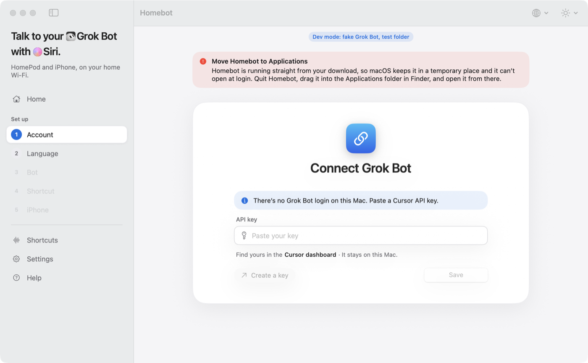
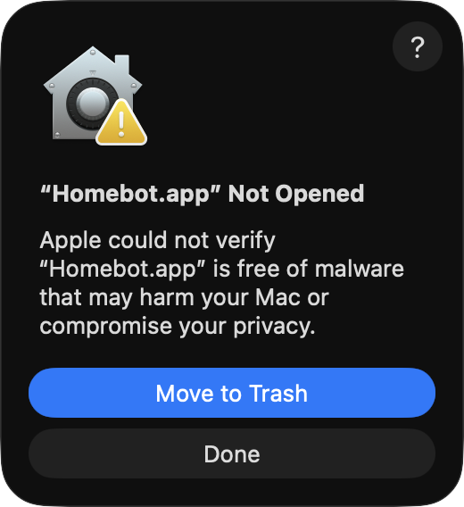
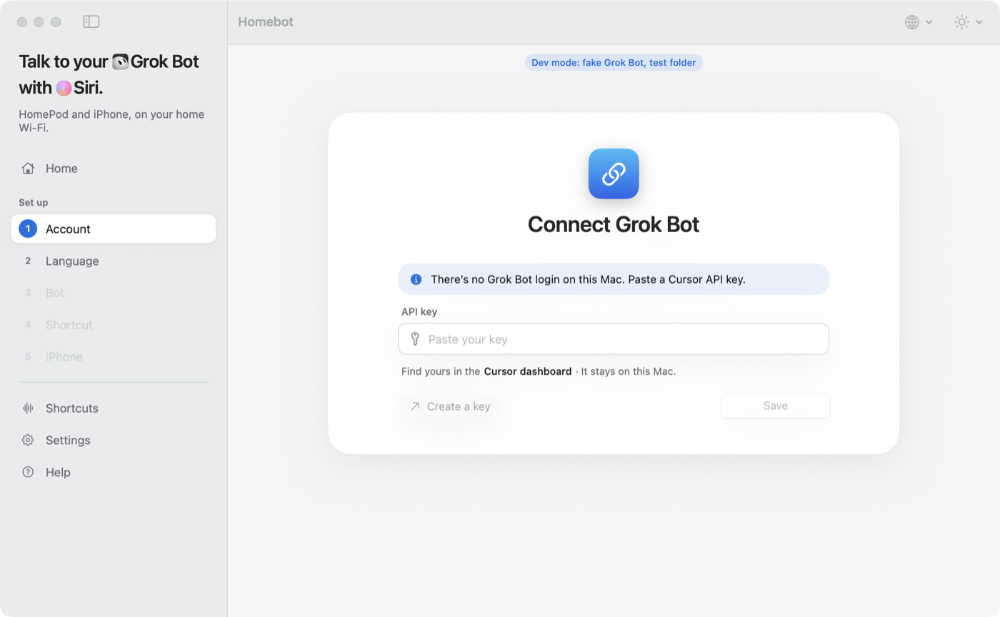
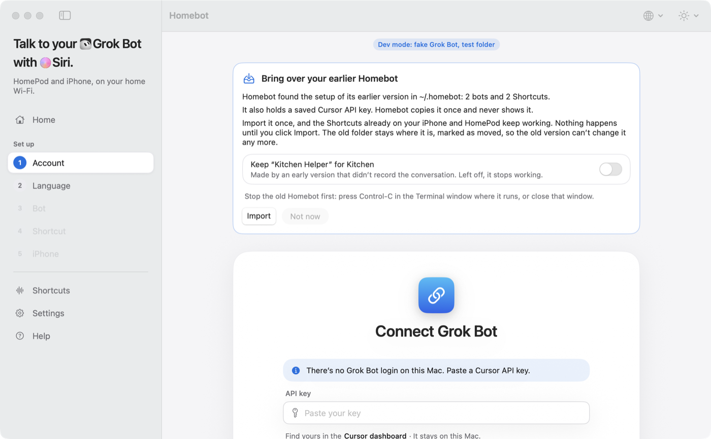

# Install Homebot on your Mac

[简体中文](INSTALL.zh-Hans.md)

You need a Mac with macOS 15 (Sequoia) or later, Apple silicon or Intel. Installing takes about five minutes and only clicks: no Terminal.

Homebot is free and not sold through the App Store. Its developer has no paid Apple developer account, so Apple has not checked ("notarized") it. macOS therefore stops it the first time, and you allow it once in System Settings. These steps show how.

## 1. Download

[Download Homebot](https://homebot.fun/download/latest?from=github) (the newest `Homebot-<version>.zip`). If that link doesn't work, take it from the [Releases page](https://github.com/lumpinif/Homebot/releases).

## 2. Open the zip and move Homebot to Applications

1. Open your **Downloads** folder and double-click the zip file. Finder puts **Homebot** next to it.
2. Drag **Homebot** into the **Applications** folder (in the Finder sidebar).

Don't open Homebot straight from Downloads. macOS would then run it from a temporary place, and it could not open by itself when you log in. If you do, Homebot says so at the top of its window:

Quit it (Homebot menu › Quit Homebot), move it to Applications, and open it from there.

## 3. Open it the first time: "Not Opened"

Double-click **Homebot** in Applications. macOS shows this message:

Click **Done**. Do not click Move to Trash.

## 4. Allow it in System Settings: Open Anyway

1. Open **System Settings** (Apple menu › System Settings).
2. Click **Privacy & Security** in the sidebar.
3. Scroll down to **Security**. Next to the line saying that "Homebot.app" was blocked, click **Open Anyway**.
4. Confirm with your Mac password or Touch ID.

The Open Anyway button is there for about an hour after step 3. If it is gone, open Homebot again (step 3) and come back.

*(Picture pending: this step has not been captured yet. On the Mac used for these pictures, the "was blocked" line had not appeared yet while the message from step 3 was still open.)*

## 5. Open Homebot

If macOS asks once more, click **Open Anyway**. Homebot opens its window and adds an icon to the menu bar. Closing the window keeps Homebot running for Siri; Quit in the menu bar icon stops it.

Now follow the window's four steps: **Account → Bot → Shortcut → Install**. In Install, choose **This Mac** if your iPhone uses the same Apple Account and iCloud Sync for Shortcuts is on (iCloud brings the Shortcut over; not yet checked on a device), or **iPhone** to send it by AirDrop or QR code. One answer, on the Mac or by tapping the Shortcut on the iPhone, finishes setup. Then, in **Settings**, turn on **Open at login** and leave **Keep this Mac awake for Siri** on, so Siri can always reach it.

### Used the earlier version of Homebot?

If you ran the earlier Homebot (started from Terminal), the new app finds its settings and offers to bring them over. Nothing happens until you click **Import**. Stop the old Homebot first (Control-C in its Terminal window, or close that window). Your Shortcuts on the iPhone and HomePod keep working.

## After each update

macOS treats every new version as a new app. After you replace Homebot with a newer version, steps 3 to 5 come back once: **Not Opened** › **Done** › **System Settings › Privacy & Security › Open Anyway** › open. Your settings, bots and Shortcuts stay as they were.

To update: quit Homebot, then drag the new Homebot into Applications and choose **Replace**.

## If something goes wrong

| What happens | What to do |
|---|---|
| No Open Anyway button | It appears only after you tried to open Homebot (step 3), and stays for about an hour. Open Homebot again, click Done, then look again. |
| You clicked Move to Trash | Download the zip again and start over at step 2. |
| "Move Homebot to Applications" at the top of the window | Quit Homebot, drag it into Applications, open it from there. |
| Open at login asks for approval | Click **Open Login Items** in Homebot's settings and allow Homebot there. |
| Siri says it can't reach Homebot | Homebot must be running and the Mac awake. See the Home page in Homebot. |

The same steps are in Homebot itself, under **Help**.
