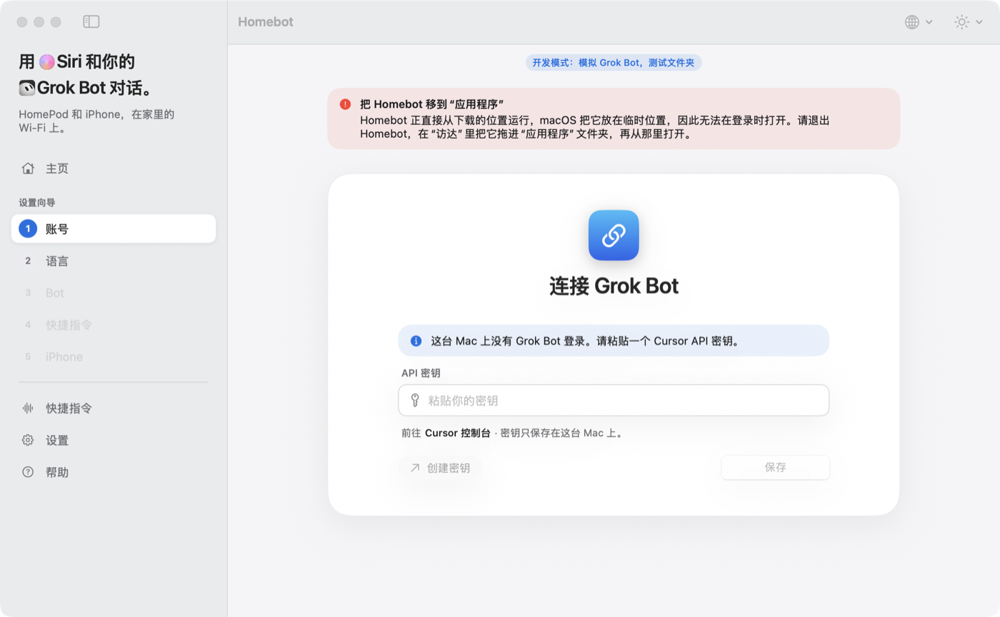
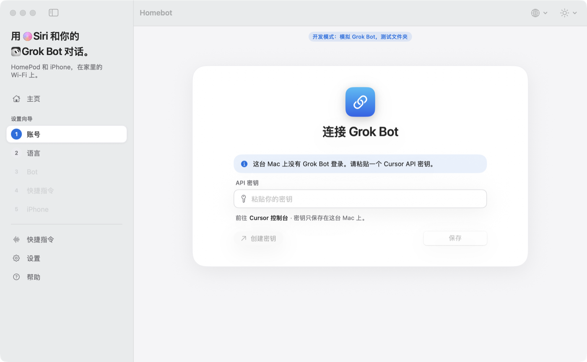
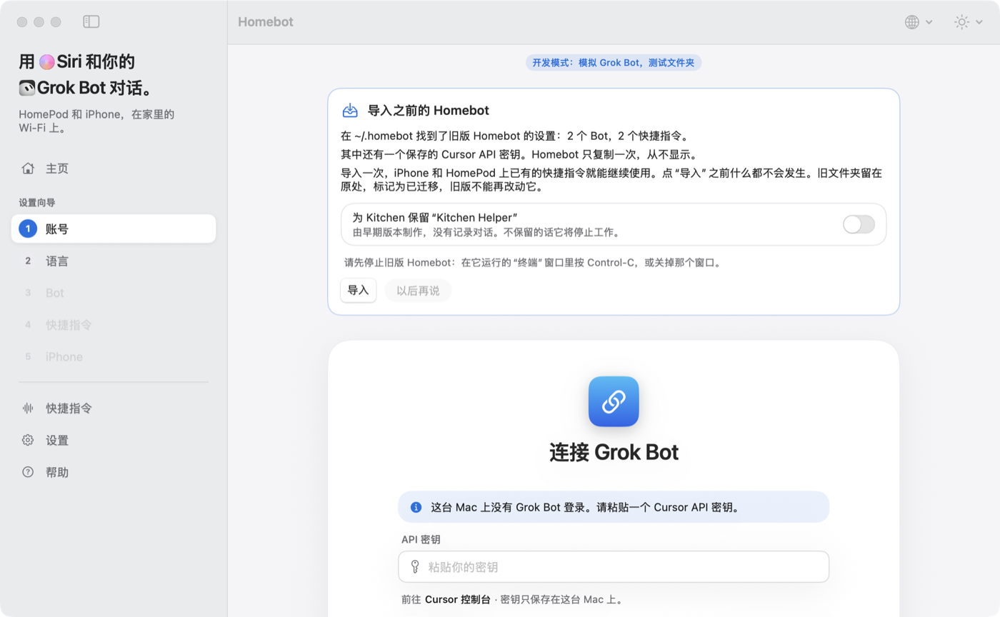

# 在 Mac 上安装 Homebot

[English](INSTALL.md)

需要一台装有 macOS 15（Sequoia）或更新版本的 Mac，Apple 芯片或 Intel 都可以。安装大约五分钟，全程只需点击，不用“终端”。

Homebot 是免费的，不在 App Store 上架。开发者没有付费的 Apple 开发者账号，所以 Apple 没有对它做过“公证”。因此第一次打开时 macOS 会拦住它，你需要在“系统设置”里允许一次。下面一步步说明。

## 1. 下载

[下载 Homebot](https://homebot.fun/download/latest?from=github)（最新的 `Homebot-<版本>.zip`）。如果这个链接打不开，就到 [Releases 页面](https://github.com/lumpinif/Homebot/releases) 下载。

## 2. 打开 zip，把 Homebot 移到“应用程序”

1. 打开“下载”文件夹，双击 zip 文件。“访达”会在旁边放出 **Homebot**。
2. 把 **Homebot** 拖到“访达”边栏里的 **应用程序** 文件夹。

不要直接从“下载”里打开 Homebot。那样 macOS 会把它放在临时位置运行，它就无法在你登录时自动打开。如果这样打开了，Homebot 会在窗口顶部提醒你：

退出它（菜单栏 Homebot › 退出 Homebot），移到“应用程序”，再从那里打开。

## 3. 第一次打开：“未打开”

在“应用程序”里双击 **Homebot**。macOS 会弹出提示，说无法验证“Homebot.app”不含恶意软件，所以没有打开它。下图是英文系统里的样子，中文系统里文字是中文：

点 **完成**（英文系统里是 Done）。不要点 **移到废纸篓**（Move to Trash）。

## 4. 在“系统设置”里允许：仍要打开

1. 打开 **系统设置**（苹果菜单 › 系统设置）。
2. 在边栏点 **隐私与安全性**。
3. 向下滚动到 **安全性**。在提示“Homebot.app”已被阻止的那一行旁边，点 **仍要打开**。
4. 用 Mac 的登录密码或触控 ID 确认。

“仍要打开”按钮在第 3 步之后大约保留一小时。如果找不到了，就再打开一次 Homebot（第 3 步），然后回到这里。

*（此步截图待补：在拍摄这些截图的 Mac 上，第 3 步的提示还开着时，“已被阻止”那一行还没有出现。中文界面的按钮名称取自 macOS 中文版的常用叫法，尚未在中文系统上截图核对。）*

## 5. 打开 Homebot

如果 macOS 再问一次，点 **仍要打开**。Homebot 会打开窗口，并在菜单栏放一个图标。关掉窗口后 Homebot 仍会为 Siri 运行；在菜单栏图标里选“退出”才会停止。

接下来按窗口里的四步操作：**账号 → Bot → 快捷指令 → 安装**。在“安装”里，如果 iPhone 和这台 Mac 用同一个 Apple 账户并打开了快捷指令的 iCloud 同步，选 **这台 Mac**（iCloud 会把快捷指令同步过去，尚未在设备上验证）；否则选 **iPhone**，用隔空投送或扫码发送。在 Mac 上，或在 iPhone 上点一下快捷指令，得到一次回答，设置就完成了。然后在 **设置** 里打开 **登录时打开**，并保持 **为 Siri 让这台 Mac 保持唤醒** 开着，这样 Siri 随时都能联系到它。

### 用过旧版 Homebot？

如果你用过旧版 Homebot（从“终端”启动的那个），新应用会找到它的设置并询问是否导入。点 **导入** 之前什么都不会发生。请先停止旧版（在它的“终端”窗口里按 Control-C，或关掉那个窗口）。iPhone 和 HomePod 上的快捷指令会继续可用。

## 每次更新之后

macOS 会把每个新版本当作一个新应用。用新版本替换 Homebot 后，第 3 到 5 步会再出现一次：**未打开** › **完成** › **系统设置 › 隐私与安全性 › 仍要打开** › 打开。你的设置、Bot 和快捷指令都保持不变。

更新方法：退出 Homebot，把新的 Homebot 拖进“应用程序”，选择 **替换**。

## 遇到问题

| 现象 | 怎么办 |
|---|---|
| 找不到“仍要打开” | 只有在你尝试打开 Homebot（第 3 步）之后才会出现，并保留大约一小时。再打开一次 Homebot，点“完成”，然后再看。 |
| 点了“移到废纸篓” | 重新下载 zip，从第 2 步开始。 |
| 窗口顶部提示“把 Homebot 移到‘应用程序’” | 退出 Homebot，把它拖进“应用程序”，再从那里打开。 |
| “登录时打开”需要批准 | 在 Homebot 设置里点 **打开登录项**，在那里允许 Homebot。 |
| Siri 说联系不到 Homebot | Homebot 必须在运行，Mac 必须醒着。请看 Homebot 的主页。 |

同样的步骤也在 Homebot 里的 **帮助** 页面。
